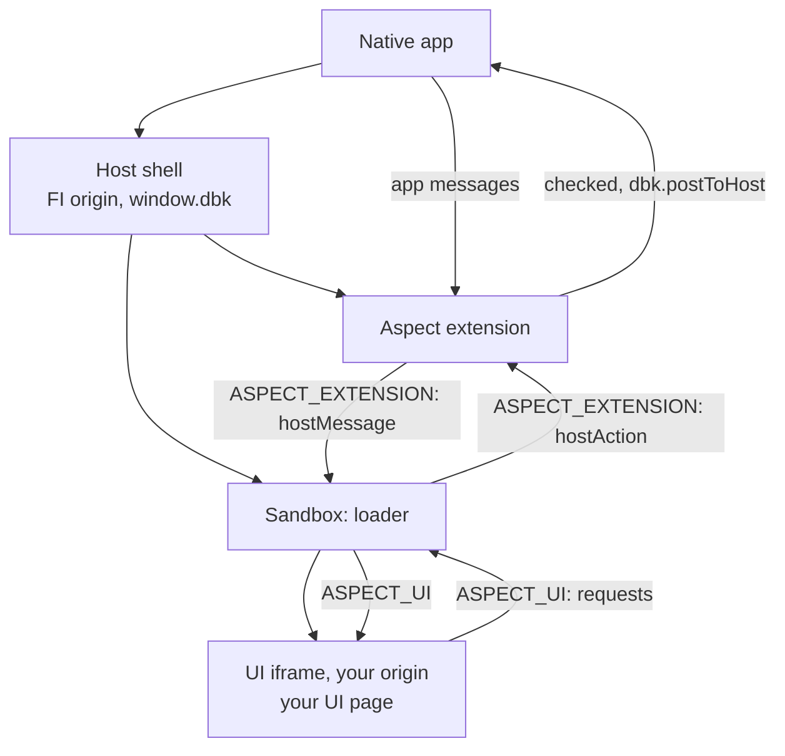
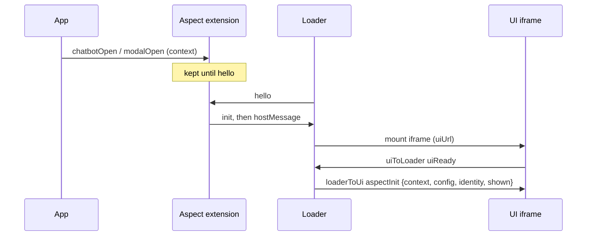
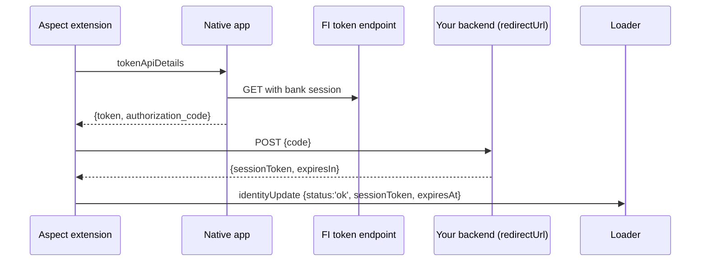
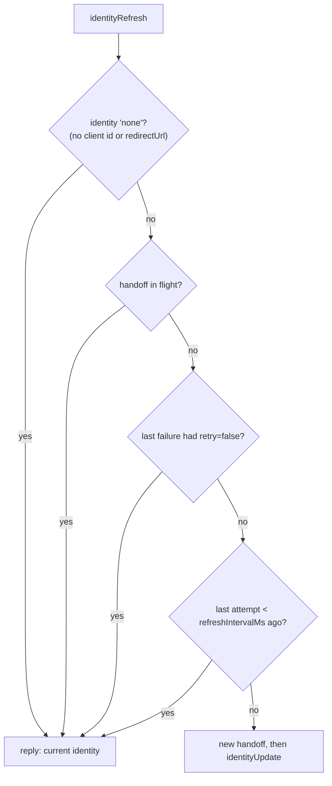
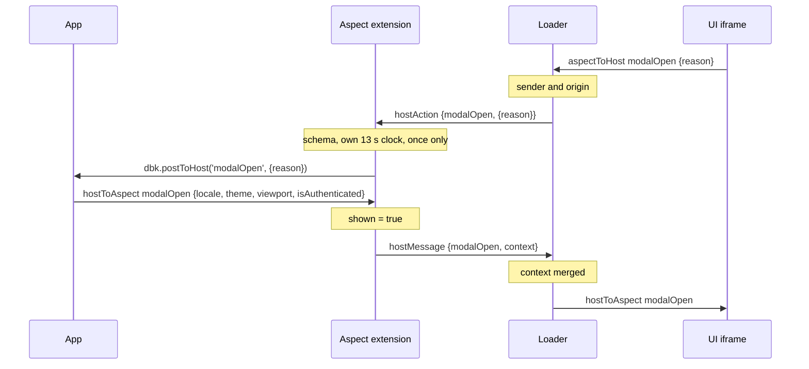

# Mobile aspects: layers, message bus and OIDC identity

How a mobile **Chatbot** or **Modal** aspect is built, and the rules each piece must follow. The sample templates (`chatbot`, `modal`) implement everything described here, so use them as the reference when you build your own aspect, by hand or with an AI coding agent.

All rules follow aspect manifest schemaVersion 2.0.0. The [preview](../../../playground/aspects-mobile/README.md) checks most of them for you.

## 1. Layers

Names used here: the **aspect extension** is `aspect-extension.js`, committed to your FI repo as `aspects/mobile/<name>/<name>.js` (earlier docs call it the bootstrap). The **static loader** is `static-loader.js` (hosted as `static-loader.vN.js`), the SRI-pinned script it loads into the sandbox. The UI page is the only file named for what it shows. "Loader" below is short for the static loader.

The **Script Name** is the key that ties the three together: it names the loader's URL, SRI and Data Attributes in the submission (`ASPECT_SCRIPT_<Script Name>_…`, see section 7), and the aspect extension passes the same string to `dbk.loadSecureExternalScript(<Script Name>)`. In the templates this constant is called `staticLoaderKey`. `loadSecureExternalScript` creates the sandbox iframe and loads the loader into it with its SRI.

```text
Native app (iOS / Android)                                         owner
└─ Host shell web view: FI origin, aspect CSP + per-load nonce     Candescent
   ├─ dbk runtime (window.dbk, message relay)                      Candescent
   ├─ Token bridge (native tokenApiDetails handler)               Candescent
   ├─ Aspect extension (aspect-extension.js)                      you, committed to your FI repo
   └─ Sandbox iframe ("main"): allow-scripts allow-same-origin     created by the runtime, FI origin
      └─ Static loader (static-loader.js)                           you, SRI-pinned, your CDN
         └─ UI iframe ("child"): uiUrl                              you, your origin (frame-src)
Your backend: code exchange, your session, your APIs               you
```

The app's runtime defines `window.dbk` in the host shell before it runs the aspect extension there, so the aspect extension uses `window.dbk` directly; the sandbox is always the host shell's direct child. **Only the aspect extension talks to the app**, in both directions: it sends with `dbk` and reads the app's messages on its own window. The loader talks only to the aspect extension (the aspect extension channel, by `postMessage` to `window.parent`) and to your UI.

The sandbox shares the FI origin with the host shell. The boundary that matters is between the sandbox (FI origin) and the UI iframe (your origin). Everything that crosses it goes through the message bus below.



## 2. Responsibilities

| Layer                             | Owns                                                                                                                                              | Must                                                                                                                                                                                                                                                                                                                                                                                                                                                                                    | Must not                                                                                                                                                                                                                                        |
| --------------------------------- | ------------------------------------------------------------------------------------------------------------------------------------------------- | --------------------------------------------------------------------------------------------------------------------------------------------------------------------------------------------------------------------------------------------------------------------------------------------------------------------------------------------------------------------------------------------------------------------------------------------------------------------------------------- | ----------------------------------------------------------------------------------------------------------------------------------------------------------------------------------------------------------------------------------------------- |
| **App and runtime**               | The manifest check, the sandbox, CSP and nonce, placement and size, display, frequency cap, the navigate rule, the bank session, the token bridge | Drop an aspect that breaks the manifest. Refuse undeclared actions and extra payload keys. Send context to the aspect.                                                                                                                                                                                                                                                                                                                                                                  |                                                                                                                                                                                                                                                 |
| **Aspect extension** (host shell) | The link to the app. The identity broker. Loading the loader.                                                                                     | Use `window.dbk`. Check every request from the loader against the manifest schema (and, for a modal, the lifecycle), send it with `dbk.postToHost`, and refuse the rest with `messageRejected`. Pass the app's messages to the loader. Read `oidcClientId`, `redirectUrl` and the timeouts from the aspect properties (`dbk.getAspectConfig().properties`). Get a code through `tokenApiDetails` and give it only to `redirectUrl`. Call `dbk.loadSecureExternalScript(<Script Name>)`. | Render UI. `postMessage` on its own window, because the runtime relays to the app any same-window message that is an `ASPECT_MESSAGE` or has an `action` key. Log or store the code. Hold a client secret.                                                                                       |
| **Static loader** (sandbox)       | Your UI's frame and its end of the bus                                                                                                            | Read its Data Attributes from `data-aspect-config` on its own `<script>` tag; validate them and fail closed. Mount exactly one UI iframe on the registered origin. Accept UI messages only from that iframe and origin, and pass its requests to the aspect extension. Pass the aspect extension's messages to the UI. Pass the UI only your session.                                                                                                                                   | Use `dbk`. Post the app's `ASPECT_MESSAGE` envelope, or act on the copies of app messages the runtime also posts into the sandbox. Render product UI. Call the token bridge. Use `eval`, `innerHTML`, `document.write`, `window.open` or forms. |
| **UI page** (child iframe)        | Product UI and state                                                                                                                              | Talk only to `window.parent`, using the `ASPECT_UI` envelope. Fix the loader's origin from `aspectInit` and check it against the FI origins it serves. Send manifest actions only, with exact payloads. Put the session token only in calls to your backend.                                                                                                                                                                                                                            | Read FI cookies or tokens (it can't). Open links itself: use `navigate`. Assume the modal is visible before the app's `modalOpen` arrives.                                                                                                      |
| **Your backend**                  | Code exchange and your session                                                                                                                    | Swap the code for tokens server side, using the client secret. Validate the ID token. Issue its own short-lived token. Use CORS limited to the FI origins it serves.                                                                                                                                                                                                                                                                                                                    | Return Candescent tokens to the browser. Trust user data sent by the browser.                                                                                                                                                                   |

**Data Attributes reach the loader as one JSON object.** You submit one plain string per attribute (`ASPECT_SCRIPT_<Script Name>_DATA_<key>`). The platform collects them into the script's `scriptData`, and the runtime puts that object on the loader's `<script>` tag as `data-aspect-config`, for example `data-aspect-config='{"uiurl":"https://chat.example.com/ui.html","title":"Need help?"}'`. Read it with `JSON.parse(document.currentScript.getAttribute('data-aspect-config'))`; capture `document.currentScript` when the file first runs (it is `null` later), and fall back to `document.querySelector('script[data-aspect-config]')`. Keys can arrive lowercased, so look them up case-insensitively. Values are normally strings, but numbers and booleans are passed on as they are, and a `null` may arrive as `null` or be left out. Convert with `String(value)` and treat a missing key as unset. With no Data Attributes the attribute is absent: treat that as `{}`. A value can also be JSON text: it arrives as a string, so `JSON.parse` it inside a `try` and check every field.

**The UI's list of FI origins.** Nothing on the bus tells the UI which bank it is serving, so the UI page keeps its own allowlist of FI origins (for example `ALLOWED_HOST_ORIGINS = ['https://www.your-bank.com']`) and accepts `aspectInit` only from one of them. Include each FI's test domain while you test there (the domain shown as "FI Domain" in the test app). The local preview runs the sandbox on the preview's own origin, so add that origin only in local builds.

**This split is about who owns what, not a security boundary.** The sandbox shares the FI origin with the host shell and the runtime gives it `dbk` too, so a loader could reach the app itself. Following the split keeps every app call in the aspect extension, which is reviewed in your FI repo's pull request. What protects the customer is the app's own manifest checks and its limits on the token bridge, the loader's SRI pin and that review. The UI iframe's separate origin keeps your UI away from the FI page, its cookies and `dbk`. Don't rely on the frame layout to block calls to the app: keep every app call in the aspect extension, and treat anything your UI page loads as able to act for the aspect.

## 3. Message bus

Three hops, each with its own envelope:

| Hop                       | Envelope                                                                                                                                                                  |
| ------------------------- | ------------------------------------------------------------------------------------------------------------------------------------------------------------------------- |
| UI ↔ loader               | `{ type: 'ASPECT_UI', version: '1.0', direction, action, payload }`                                                                                                       |
| loader ↔ aspect extension | `{ type: 'ASPECT_EXTENSION', version: '1.0', direction: 'loaderToExtension' \| 'extensionToLoader', name, payload }`                                                      |
| aspect extension ↔ app    | The app's `ASPECT_MESSAGE`. Out: `dbk.postToHost(action, payload)` sends `{ type: 'ASPECT_MESSAGE', version: '1.0', aspectId, action, payload }`. In: the same envelope plus `direction: 'hostToAspect'` |

**UI ↔ loader** (`ASPECT_UI`):

| direction      | From → to                            | Actions                                                                                                                                                       | Who checks it                                                                                                                                                                                           |
| -------------- | ------------------------------------ | ------------------------------------------------------------------------------------------------------------------------------------------------------------- | ------------------------------------------------------------------------------------------------------------------------------------------------------------------------------------------------------- |
| `aspectToHost` | UI → loader → aspect extension → app | The manifest `aspectToHost` actions for the type, with exact payloads                                                                                         | Loader: source is the UI iframe and origin is the `uiUrl` origin. Aspect extension: the schema (and the modal lifecycle). App: the schema again.                                                        |
| `hostToAspect` | app → aspect extension → loader → UI | The manifest `hostToAspect` actions                                                                                                                           | Aspect extension: an event the runtime created (no source, no origin), a declared action. Loader: from the aspect extension. UI: source is `window.parent` and origin is the one fixed by `aspectInit`. |
| `uiToLoader`   | UI → loader only                     | `uiReady`, `identityRefresh`                                                                                                                                  | Loader.                                                                                                                                                                                                 |
| `loaderToUi`   | loader → UI only                     | `aspectInit {schemaVersion:1, aspectType, context, config, identity}` (a modal adds `shown`), `identityUpdate {identity}`, `messageRejected {action, reason}` | UI                                                                                                                                                                                                      |

`aspectToHost` and `hostToAspect` keep the manifest's names, since they carry the manifest's actions. The other directions name the two pieces that talk: `uiToLoader` / `loaderToUi`, and `loaderToExtension` / `extensionToLoader` below.

Here `identity` is `{ status: 'ok', sessionToken, expiresAt }` (`expiresAt` in epoch milliseconds), `{ status: 'pending' | 'none' }` or `{ status: 'failed', reason }` (reasons in section 4).

- `aspectInit.config` is the loader's display settings from its Data Attributes, after validation. The loader and UI are both yours, so the keys are your own contract; the templates use camelCase (`title`, `greeting`, `accentColor`, `helpUrl` for the chatbot; `title`, `body`, `ctaText`, `ctaUrl`, `accentColor` for the modal). Include links the UI opens with `navigate` (such as `ctaUrl`), but never `uiUrl` or `configUrl`. `aspectInit.context` is the latest context from the app, or `{}` if none has arrived yet; later context comes as `hostToAspect` `chatbotOpen` / `contextUpdate` / `modalOpen`.
- The loader keeps app messages that arrive before `uiReady` and sends them after `aspectInit`.
- `uiReady` is the UI's first message, before it knows the loader's origin, so it is posted with target `'*'`; it carries no data. Every later message uses the origin fixed by `aspectInit`.
- `messageRejected.reason` is a short human-readable text for logs (for example `status must be one of user_minimized, session_ended`). Don't branch on its wording.
- Messages with no payload (`hello`, `identityRefresh`, `uiReady`) may omit `payload` or send `{}`; receivers must accept both.

**Loader ↔ aspect extension** (`ASPECT_EXTENSION`). These messages are not `ASPECT_MESSAGE`s and have no `action` key, so the runtime's relay never forwards them to the app:

| direction           | name                                        | payload                                                   |
| ------------------- | ------------------------------------------- | --------------------------------------------------------- |
| `loaderToExtension` | `hello` (once, at start), `identityRefresh` | none                                                      |
| `loaderToExtension` | `hostAction`                                | `{ action, payload }`: a UI request for the app           |
| `extensionToLoader` | `init` (answer to `hello`)                  | `{ configTimeoutMs, identity }`, plus `shown` for a modal |
| `extensionToLoader` | `identityUpdate`                            | `{ identity }`                                            |
| `extensionToLoader` | `hostMessage`                               | `{ action, payload }`: a message from the app             |
| `extensionToLoader` | `messageRejected`                           | `{ action, reason }`: a refused `hostAction`              |

The aspect extension answers only a child frame of its own window on the FI origin: it checks `event.origin === window.origin` and replies with `event.source.postMessage(msg, window.origin)`. The loader mounts the UI after `init`, and after its runtime config if it has one (below).

**Runtime config (optional).** A loader can take a `configUrl` Data Attribute: a JSON file on your origin that it fetches (`credentials: 'omit'`) after `init`, with `configTimeoutMs` from `init` as the timeout. The templates expect `{ schemaVersion: 1, isActive: true, ... }`, and may override `uiUrl` only with one on the same origin. If the fetch fails, times out or is invalid, or `isActive` isn't `true`, the loader mounts nothing. Without `configUrl`, `configTimeoutMs` is unused.

**How the runtime delivers app messages** (`aspect_runtime_loader.js`, iOS and Android): it posts each one into the sandbox and also fires it on the host shell window as a `message` event it creates, with no source (`null`) and no origin (`''`). Its `event.data` is the `ASPECT_MESSAGE` envelope with `direction: 'hostToAspect'`. The aspect extension reads that second copy (`!event.source && !event.origin`); the loader ignores the first. The app's opening message can arrive before the loader says `hello`, so the aspect extension keeps app messages until then. A `host_immediate` modal gets its `modalOpen` as soon as the host shell loads, usually before the aspect extension has run, so it is often lost: treat that modal as shown from the start, with `{}` as the context until a later message arrives.

**The relay.** The runtime also forwards to the app any same-origin message posted on the host shell by itself or the sandbox when it is an `ASPECT_MESSAGE` or has an `action` key, unless its `direction` is `hostToAspect`. That is why the aspect extension never posts on its own window and the loader never posts the app's envelope.



**Manifest actions** (schemaVersion 2.0.0, mobile):

| Type    | aspectToHost (UI may send)                                                                                                                                              | hostToAspect (UI receives)                                                                                                                                                              |
| ------- | ----------------------------------------------------------------------------------------------------------------------------------------------------------------------- | --------------------------------------------------------------------------------------------------------------------------------------------------------------------------------------- |
| chatbot | `chatbotOpen {reason: user_clicked_fab \| proactive_engagement \| new_message_received}`, `chatbotMinimize {status: user_minimized \| session_ended}`, `navigate {url}` | `chatbotOpen` (context, sent once right after the loader loads; it does not mean "open"), `contextUpdate` (context, only when a value has changed since the last one sent; the app checks as the customer moves between screens, so don't expect it at a particular moment), `chatbotMinimize {status: host_minimized}` (Android back; iOS never sends it) |
| modal   | `modalOpen {reason}`, `modalDismiss {status: success \| cancelled \| error, actionData?}`, `navigate {url}`                                                             | `modalOpen` (the app has shown the modal; context), `modalDismiss {cancelled}` (scrim tap; also the back button on Android)                                                             |

- Context is `{locale, theme, viewport, isAuthenticated}`. On mobile, `viewport` is `"mobile"` and `isAuthenticated` is `true`. `theme` is left out when the app can't tell.
- Payloads take no extra keys, so `navigate` takes `url` and nothing else. Keep each message under 64 KB; larger ones may be refused. `modalDismiss.actionData` must be an object, but any keys are allowed inside it.
- `navigate.url` is one of:
  - an in-app route that maps to a mobile screen: `/app/home` or `/app/home/olb/accounts` (Home), `/app/home/settings/overview` (My Settings). Other routes do nothing;
  - `feature:<featureId>`: one of the app's supported features (for example `Transfers`, `BillPay`, `Messages`), if it is enabled for the customer. The app shows the feature's usual notice first, if it has one;
  - an https URL whose host is exactly the bank's online banking host, or matches a host source in this aspect's CSP `frame-src` / `connect-src` (`https://` or no scheme; `*.example.com` = subdomains only; `'self'`, `http://` sources, a bare `*` and a one-label wildcard such as `*.com` don't count). It opens outside the app: in the browser, or in an app that handles that link.

  Anything else is refused.
- The aspect extension checks only the form (a path starting with `/`, `feature:<id>`, or an `https://` URL) and leaves the rest to the app, which alone knows which routes map to a screen and which features are enabled.
- The templates keep the modal `reason` to a snake_case id. The manifest itself allows any string.

**Origin note:** use `window.origin` for the sandbox's own origin. `location.origin` is `"null"` in a `srcdoc` frame, such as the local preview.

## 4. OIDC identity handoff (optional)

Use this when your backend needs to know who the customer is. The aspect side follows [Authentication via native bridge](https://docs.candescent.com/guides/Building%20Extensions/Aspects/Mobile/technical-reference/#authentication-via-native-bridge): the aspect only receives a one-time code, and your backend does the token exchange and every API call ([OIDC for Aspects FAQ](https://docs.candescent.com/guides/Building%20Extensions/Aspects/faq/#oidc-for-aspects)). The exchange itself follows the [OIDC Integration technical reference](https://docs.candescent.com/guides/OIDC%20Integration/technical-reference/).

The Mobile technical reference also covers aspects built as one full HTML page. Only the sections linked from this document apply to these templates.

It is configured with aspect properties, which the aspect extension reads from `dbk.getAspectConfig().properties` (key case doesn't matter). `dbk.getAspectConfig()` is synchronous. The platform sends `properties` keys lowercase and without the `ASPECT_PROPERTY_MOBILE_` prefix (`oidcclientid`, `redirecturl`, `tokentimeoutms`, …); the app passes them on unchanged, so match them case-insensitively. Data Attributes are the loader's (section 2), so the aspect extension doesn't use them.

- `oidcClientId`: the public client id your Candescent Integration PM issues, along with the client secret and the JWKS file ([overview, step 4](https://docs.candescent.com/guides/OIDC%20Integration/overview/#4-integration-testing-in-fi-environments)). Never put the secret here.
- `redirectUrl`: your backend endpoint that receives the code (https; its origin goes into `connect-src`). It is not an OAuth `redirect_uri`: nothing redirects the browser.
- `tokenTimeoutMs` (5000), `redirectTimeoutMs` (5000), `refreshIntervalMs` (30000) and `configTimeoutMs` (8000, for the loader's runtime config, passed on in `init`). The defaults apply only when a property is missing.

The submission form checks the formats (client id pattern, https URL, whole milliseconds); the aspect extension doesn't repeat those checks. If `oidcClientId` or `redirectUrl` is missing, identity is `none` and the aspect works anonymously.

The templates write these as `ASPECT_PROPERTY_MOBILE_<NAME>` in the metadata, with `<NAME>` in upper case and no separators (`ASPECT_PROPERTY_MOBILE_OIDCCLIENTID`, `ASPECT_PROPERTY_MOBILE_REDIRECTURL`), and the preview hands them to the aspect extension as `properties`. Values are strings, so parse the timeouts as whole numbers.



1. **Aspect extension** asks the app for a code with `tokenApiDetails` ([Sending Authentication Request](https://docs.candescent.com/guides/Building%20Extensions/Aspects/Mobile/technical-reference/#sending-authentication-request)). It starts the first handoff as soon as it runs, so identity is often ready by `init` (otherwise `init` carries `pending`).
   - iOS: `window.webkit.messageHandlers.tokenApiDetails.postMessage(json)`.
   - Android: `window.JSBridge.tokenApiDetails(json)`.
   - `json` is a JSON **string**: `JSON.stringify({url: <FI origin>/feng-bff/live/v1/aspect/token?clientId=…, method:'GET', headers:{Cookie:''}})`. Send exactly `headers: {Cookie: ''}`: the app attaches the customer's session itself, and some app versions need this empty header to do it.
   - Only the aspect extension calls the bridge. It is part of the app link the extension owns, like `dbk`.
2. **App** fetches the URL natively with the bank session. Use exactly the URL above (https, the FI host, `/feng-bff/live/v1/aspect/token`, with `clientId` as the only parameter) and `GET`; anything else may be dropped without an answer. The app puts the parsed JSON body (normally an object) on `dbk.tokenResponse` and fires `apiToken:ready` on the host shell `window`; the runtime fires it in the sandbox too, so the loader could also see the code (another reason the split isn't a security boundary) ([Receiving the Token](https://docs.candescent.com/guides/Building%20Extensions/Aspects/Mobile/technical-reference/#receiving-the-token)). `dbk.tokenResponse` is one shared slot: clear it before each request and after reading it. If the request is refused or fails, or the body isn't JSON, it sends nothing, so the aspect extension times out after `tokenTimeoutMs`. You get the body only, never the HTTP status, so check `token_type` first, then the body's own fields.
3. The answer is `{token, token_type:'authorization_code'}`: a one-time code for the signed-in customer. Errors are a body `{statusCode, error, message, details}`; match on `error` (the exception name), `details.code` and the body's `statusCode`. The aspect extension maps them to a `reason`:

   | Answer                                                                                                                                                           | `reason`                   | Refresh retries? |
   | ---------------------------------------------------------------------------------------------------------------------------------------------------------------- | -------------------------- | ---------------- |
   | 401 `SessionUnauthorizedException` (no bank session, or it expired)                                                                                              | `session_expired`          | no               |
   | 400 `ValidationException` (clientId missing or malformed)                                                                                                        | `invalid_client_id`        | no               |
   | 401 `ClientUnauthorizedException`, `details.code` `CMN_90007` (client id not registered for this FI and environment)                                             | `client_not_authorized`    | no               |
   | 401 `ClientUnauthorizedException`, any other details (a code can't be issued right now) | `code_unavailable`         | yes              |
   | 404                                                                                                                                                              | `token_endpoint_not_found` | no               |
   | 5xx or any other JSON                                                                                                                                            | `code_unavailable`         | yes              |
   | No answer within `tokenTimeoutMs` (URL refused, network error, non-JSON body such as a gateway page) | `code_timeout`             | yes              |
   | No token bridge (not in the app)                                                                                                                                 | `no_token_bridge`          | no               |

4. **Aspect extension** sends `POST redirectUrl` with body `{"code": "…"}` as `Content-Type: application/json` (so your backend must answer the CORS preflight), `credentials:'omit'` and a `redirectTimeoutMs` timeout. Failures are `redirect_http_<status>`, `redirect_unreachable` (network, CORS or `connect-src`), `redirect_bad_response` and `redirect_timeout`; all can be retried, because a new code can fix an expired or reused one.
5. **Your backend**:
   - Exchanges the code at the Candescent token endpoint (`client_secret_basic` or `_post`). Stage: `https://api.stage.candescent.com/oauth2/v1/token`; production: `https://api.candescent.com/oauth2/v1/token`. See [Token exchange](https://docs.candescent.com/guides/OIDC%20Integration/technical-reference/#token-exchange). Confirm with your Integration PM whether your client needs `redirect_uri`.
   - Validates the ID token, following [ID token validation](https://docs.candescent.com/guides/OIDC%20Integration/technical-reference/#id-token-validation):
     - RS256 signature, checked with the JWKS **file** from your PM;
     - `iss` = `https://www.digitalinsight.com`;
     - `exp` in the future.
   - Skips the `aud` and `nonce` checks: the ID token has no `aud` claim, and this flow sends no `nonce` or `state`.
   - Uses the code at once: it lives 60–120 s. The ID token expires after 5 minutes and the access token after about 30 ([timeouts](https://docs.candescent.com/guides/OIDC%20Integration/technical-reference/#critical-timeouts)).
   - Maps the pairwise `sub` (see [supported claims](https://docs.candescent.com/guides/OIDC%20Integration/technical-reference/#supported-claims)) to its own user.
   - Answers `{sessionToken, expiresIn}` with a token scoped to your service; `expiresIn` is in seconds. The aspect extension turns it into `expiresAt = Date.now() + expiresIn * 1000`.
   - Can be tested locally with the [OIDC Toolkit](https://docs.candescent.com/guides/OIDC%20Integration/local-development/) and its credentials checked with [Testing your credentials](https://docs.candescent.com/guides/OIDC%20Integration/technical-reference/#testing-your-credentials).
6. **Aspect extension** sends `{status:'ok', sessionToken, expiresAt}` (or `{status:'failed', reason}`) to the loader in `init` or `identityUpdate`. It logs the reason only (`console.warn`), never the code or the token.
7. **Loader** sends `identity` in `aspectInit` (as `pending` if not yet resolved), then `identityUpdate`.
8. **UI** calls your APIs with `Authorization: Bearer <sessionToken>`. When the token is close to expiry or gets a 401, it sends `identityRefresh`. The aspect extension starts a new handoff at most once per `refreshIntervalMs` (counted from the start of the last one) and never after a failure that can't be retried; otherwise it answers with the current identity. When it does start one, it answers only with the `identityUpdate` that follows. There is no automatic retry: a failure that can be retried is retried on the next `identityRefresh`.



**Keep in mind:**

- The client id is an aspect property; there is no dedicated console field for it.
- You can test the aspect side before your backend is ready. Point `redirectUrl` at a stand-in endpoint that answers the CORS preflight and returns `{sessionToken, expiresIn}`, and add its origin to `connect-src`. In the FI's test app, identity should become `ok` within a few seconds. A client id that isn't registered for that FI gives `client_not_authorized`.
- The aspect extension is not a security boundary. It shares origin and `dbk` with the loader, so keep secrets on your backend only. The loader is SRI-pinned; the aspect extension is reviewed in your FI repo's pull request.

## 5. What gets rejected

**The app drops the whole aspect:**

- **CSP:** any directive other than `script-src`, `connect-src`, `style-src`, `img-src`, `font-src` and `frame-src`. `default-src`, `report-uri` and `report-to` are always allowed. `media-src`, `object-src`, `frame-ancestors` and `worker-src` are rejected.
- **Sandbox:** any token beyond `allow-scripts allow-same-origin`.
- **Permissions:** any granted permission (camera, microphone, geolocation, clipboard-write).
- **Placement:**
  - chatbot: anything but `bottom_right_fab`;
  - modal: anything but `bottom_sheet` or `center_overlay`.
- **Display authority:**
  - chatbot: anything but `partner_delegated`;
  - modal: anything but `partner_delegated` or `host_immediate`.
- **Scripts:** an aspect extension or loader URL that isn't https, or an SRI that is missing or isn't one valid sha256/384/512 hash.

These lists come from the manifest the app downloads (with a copy built into the app as a fallback), so the platform can change them. A placement id or display authority that is left out isn't rejected: the default applies (the launcher for a chatbot, a bottom sheet for a modal, and `partner_delegated`).

**The app logs a warning only:**

- Mount strategy, frequency or trigger outside the manifest. For a modal, `partner_delegated` allows only `always`; `host_immediate` allows `once_per_session`, `once_per_user` and `always`.
- A placement size that isn't small, medium or large.
- No CSP at all (the app then applies its own strict default, which blocks your scripts, so nothing shows), or a `script-src` with neither `'nonce-aspect'` nor an https source (your scripts will then be blocked).

**The aspect loads, but nothing shows:**

- A modal page with no mobile screen. Transaction History shows aspects on neither app.
- A `partner_delegated` modal that doesn't send `modalOpen` within 15 s. The 15 s start when the app has loaded the host shell while the modal's screen is showing, so downloading your extension, loader and UI counts.
- A modal blocked by the frequency cap.
- A Script Name that doesn't match the submission, or an aspect extension or loader that fails its SRI, the CSP or the network. When a script fails to load, the app also removes the aspect for the rest of the session.

**The app refuses the message:**

- An action that isn't declared.
- A missing required key, an extra key, a value of the wrong type, a blank string, or a value outside the enum (matched exactly, case-sensitive).
- An envelope whose `type` isn't `ASPECT_MESSAGE`, whose `version` is set to something other than `1.0`, or whose `aspectId` is another aspect's (`dbk.postToHost` gets these right).
- Don't post `aspectScriptLoaded`, `aspectScriptFailed` or `aspectBootstrapFailed`: these names are reserved for the runtime.
- A `navigate` URL that isn't an in-app route, `feature:<id>`, the bank's own host or a host in the aspect's CSP `frame-src` / `connect-src`.

The app drops a refused message silently (a log line only) and never replies, so the aspect extension refuses these first and the loader tells the UI why (`messageRejected`).

If your aspect still doesn't load or show, see [Troubleshooting in the Aspects FAQ](https://docs.candescent.com/guides/Building%20Extensions/Aspects/faq/#troubleshooting).

**Code rules** (the checker warns): no `eval`, `new Function`, `innerHTML =`, `document.write`, `window.open`, `getUserMedia` or geolocation, and no `<form>`, because the sandbox has no `allow-forms`.

## 6. Lifecycle

- **Chatbot:**
  - The app shows the aspect's frame as a 56-point square (pt on iOS, dp on Android) in the bottom-trailing corner, above the app's bottom bar, once the loader has loaded. **Your UI draws the launcher** and makes it round: while collapsed, the UI page renders just a round button that fills the whole frame (icon only; text won't fit).
  - Then the app sends `chatbotOpen` with context, once. If the context changes later, it sends `contextUpdate`.
  - The open panel's height can change while it's open (the keyboard, the app's bottom bar), so lay the UI out to fit any height.
  - The chatbot is kept for the signed-in session and follows the customer from screen to screen with its conversation intact; it isn't reloaded.
  - When the customer taps that button, the UI switches to its panel and sends `chatbotOpen {reason: user_clicked_fab}` at the same time. The app expands the frame to the panel size; the panel opens only when the aspect sends `chatbotOpen`. The app sends no confirmation, so don't wait for one; switch back to the button only if your aspect extension sends `messageRejected` for `chatbotOpen`. The app itself never says it refused one, so send a valid payload (`reason` from the manifest list, no other keys) or the frame stays launcher-sized.
  - `chatbotMinimize` from the UI collapses the frame back to the launcher; the UI switches back to the button right away. `chatbotMinimize {status: host_minimized}` from the app means it already collapsed the frame, so the UI switches without answering (Android back; iOS doesn't send it, but handle it anyway).
  - The aspect extension doesn't check the chatbot lifecycle; the app accepts `chatbotOpen` and `chatbotMinimize` at any time, as long as the payload matches the manifest.
  - **After an in-app `navigate`** (`/app/...` or `feature:<id>`), the UI also sends `chatbotMinimize {status: user_minimized}` and switches to the launcher. The app changes the screen behind the open panel and doesn't collapse it, so without this the customer sees no change. A navigate to the screen already showing may change nothing visible. Keep the panel open for an https link, because that opens in the phone's browser (only for the hosts allowed in section 3; the app ignores others).
- **Modal, `partner_delegated`:**
  - It is mounted hidden.
  - The UI sends `modalOpen` once, as soon as it gets `aspectInit`. The aspect extension can't see when the app started its 15 s, so it keeps its own clock from when it starts running and refuses `modalOpen` after 13 s (the templates' 2 s margin covers the time before it ran).
  - A `modalOpen` from the aspect more than 15 s after the app has loaded the modal's host shell on its screen (downloading your extension, loader and UI counts) is ignored.
  - When the app shows the modal, it sends `modalOpen` back. The frequency cap or the current screen can stop it.
  - A tap outside the modal, or Android back, closes it, and the app sends `modalDismiss {status: 'cancelled'}`.
  - After a dismiss, the app shows the modal again if the aspect sends another `modalOpen` (the frequency cap still applies). The templates' aspect extension refuses a second `modalOpen`.
  - A My Settings modal is loaded again on each visit, so with frequency `always` it shows again each time.
- **Display authority:** the aspect extension reads it from `dbk.getAspectConfig().lifeCycleControls.displayAuthority`, falling back to `dbk.getAspectConfig().displayAuthority` (both apps fill these in; it is not one of the `properties`). For `host_immediate` it sends `shown: true` in `init`.
- **Modal, `host_immediate`:** the app shows it as soon as its page is ready, possibly before your loader has run, then sends `modalOpen`. That `modalOpen` is usually lost (section 3).

A `partner_delegated` modal open, end to end:



- **Several chatbots:** iOS puts every chatbot launcher in the same corner, so only the front one can be tapped. Android shows only the first chatbot. Disable other chatbots for the FI while you test yours.

## 7. Submission fields (metadata)

**What you submit, and where.** Two things go to the platform; your hosted loader and UI are not among them.

- **The aspect extension** is committed to your FI repo as `aspects/mobile/<name>/<name>.js`, where `<name>` is the metadata `name`. That path is how the platform ties the file to the aspect; the metadata has no field for it. You don't host this file or supply its hash: in the manifest the app downloads, the platform serves it from its own host under `…/mobile/` (`sourceUrl`) with an SRI (`sourceSRI`), and the app loads it only if both are valid.
- **The metadata** below goes in the body of that pull request as a `Metadata:` block. `pnpm run submit-to-fi` writes both. Without a terminal, use the Developer Console: Manage Submissions → Aspects, Platform Mobile, Upload code snippet. Paste the aspect extension there and enter the same values in the form.

An aspect is submitted as a `metadata.json` (or the same values in the Developer Console form). Top-level keys: `name`, `widgetType: "ASPECT"`, `widgetDescription`, `isEnabledWeb: false`, `isEnabledMobile: true`, `sector` (`RETAIL` or `BUSINESS`) and `properties`. Each property is `{ propertyName, propertyType: "TEXT", propertyLabel, propertyValue, propertyValueLocale: "", isRichText: false, isLocalized: false, isLocked: false }`; every value is a string.

| `propertyName`                                | Chatbot                                                                 | Modal                                              |
| --------------------------------------------- | ----------------------------------------------------------------------- | -------------------------------------------------- |
| `ASPECT_TYPE`                                 | `chatbot`                                                               | `modal`                                            |
| `ASPECT_SCRIPT_<Script Name>_URL`             | Hosted loader, https, versioned                                         | same                                               |
| `ASPECT_SCRIPT_<Script Name>_SRI`             | `sha384-…` of that exact file                                           | same                                               |
| `ASPECT_SCRIPT_<Script Name>_DATA_<key>`      | One per Data Attribute, e.g. `_DATA_uiurl`, `_DATA_title` (a plain value or JSON text) | same                    |
| `ASPECT_PROPERTY_MOBILE_CONTENTSECURITYPOLICY` | Allowed directives only (section 5)                                    | same                                               |
| `ASPECT_PROPERTY_MOBILE_SANDBOXDIRECTIVES`    | `allow-scripts allow-same-origin`                                       | same                                               |
| `ASPECT_PROPERTY_MOBILE_PLACEMENTID`          | `bottom_right_fab`                                                      | `bottom_sheet` or `center_overlay`                 |
| `ASPECT_PROPERTY_MOBILE_PLACEMENTSIZE`        | Open panel height: `small` 60%, `medium` 80%, `large` 100% of the screen height, capped to the space above the app's bottom bar (default `large`) | `bottom_sheet`: `small` 40%, `medium` 60%, `large` 100% (default `medium`); ignored for `center_overlay` |
| `ASPECT_PROPERTY_MOBILE_PAGE`                 | Leave empty to show it on every screen after sign-in (it follows the customer); set it to limit the chatbot to Home or My Settings | The route to show on: `/app/home` (or `/app/home/olb/accounts`) or `/app/home/settings/overview`; other routes never show on mobile |
| `ASPECT_PROPERTY_MOBILE_DISPLAYAUTHORITY`     | `partner_delegated`                                                     | `partner_delegated` or `host_immediate`            |
| `ASPECT_PROPERTY_MOBILE_MOUNTSTRATEGY`        | `on_route_match`                                                        | `on_route_match`                                   |
| `ASPECT_PROPERTY_MOBILE_TRIGGER`              | `pageLoad`                                                              | `pageLoad`                                         |
| `ASPECT_PROPERTY_MOBILE_FREQUENCY`            | `always` or `authenticated_session` (both currently behave the same on mobile) | section 5                                          |
| `ASPECT_PROPERTY_MOBILE_<NAME>`               | Your own aspect properties, e.g. `OIDCCLIENTID`, `REDIRECTURL`, the timeouts (section 4) | same                  |

The CSP the templates start from: `script-src 'self' 'nonce-aspect'; style-src 'self' 'unsafe-inline'; img-src 'self' data:; connect-src 'self' <your backend>; frame-src 'self' <your UI origin>`. Keep `'nonce-aspect'` in `script-src`: the app replaces it with a fresh nonce on each load and puts that nonce on the aspect extension and loader `<script>` tags. That nonce, not the SRI, is why `script-src` doesn't need your loader's host; the SRI only checks the file's contents. If the CSP has no `frame-src`, the app adds `frame-src 'self'`.

## 8. Build checklist

Use this list when you build or review an aspect, or give it to your AI coding agent together with this file and the sample templates.

- [ ] Start from a template with `pnpm run create-aspect:mobile`, so the aspect extension, loader, metadata and Script Name already match.
- [ ] Aspect extension: `staticLoaderKey` equals the Script Name; it uses `window.dbk`, is the only piece that talks to the app (checks each request against the manifest schema, sends it with `dbk.postToHost`, passes the app's messages to the loader), brokers identity (settings from the aspect properties) and calls `dbk.loadSecureExternalScript`. It never posts on its own window.
- [ ] Loader: no `dbk`; one Data Attribute per setting, read from `data-aspect-config`, validated, `https` links only; fails closed on bad config.
- [ ] Loader: mounts exactly one UI iframe on the `uiUrl` origin, accepts UI messages only from it (source, origin) and passes requests to the aspect extension as `hostAction`. It never posts the app's `ASPECT_MESSAGE` envelope.
- [ ] UI page: talks only to `window.parent` through the `ASPECT_UI` envelope, and opens links with `navigate`.
- [ ] Modal: one `modalOpen` within 15 s (`partner_delegated`). The template also refuses a second `modalOpen` after a dismiss; the app itself would show the modal again under frequency `always`.
- [ ] CSP lists only the allowed directives, with your UI origin in `frame-src` and your backend in `connect-src`.
- [ ] OIDC (if used): code exchange and ID token validation on your backend only; the browser only ever holds your own session token.
- [ ] No `eval`, `innerHTML`, `document.write`, `window.open` or `<form>`.
- [ ] The hosted loader URL is versioned and never changed in place; each change gets a new URL and a new SRI.
- [ ] The preview shows no errors, and you have tried the aspect in the FI's test environment on both iOS and Android before production.
